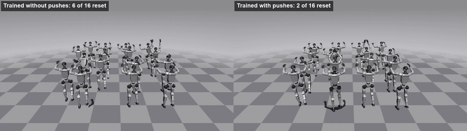
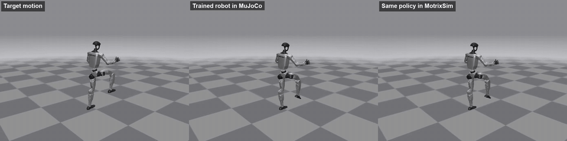

# Phone video to a simulated Unitree G1, measured

A 25-second phone video of a person moving, with arm waves, a knee raise and a kick, becomes a motion-tracking policy for a simulated Unitree G1 humanoid. This repository holds the scripts that connect the open tools, two trained policies, a measurement method that counts failures instead of judging videos by eye, and the results. Everything ran on two Apple Silicon Macs and a free Colab GPU, at no cost.



*16 robots per policy under random pushes. Left: the policy trained without pushes, 6 robots were reset. Right: the policy trained with pushes, 2 were reset. Full video: [media/before_after_pushes.mp4](media/before_after_pushes.mp4).*

## Results

Two policies were trained on the same motion with the same settings and random seed. The second adds UniLab's standard push during training: every 1 to 3 seconds the robot's velocity changes at once, by up to 0.5 m/s forwards and sideways, 0.2 m/s up or down, 0.52 rad/s of tilt and 0.78 rad/s of turn.

**Robots that played the whole 25.3-second clip without a reset:**

| Test | Robots | Trained without pushes | Trained with pushes |
|---|---|---|---|
| MuJoCo, no pushes | 3,328 | 96.5% | 98.5% |
| MotrixSim, no pushes (a second physics engine, no retraining) | 3,328 | 95.3% | 97.1% |
| MuJoCo, pushes at a quarter of the standard strength | 1,024 | 95.4% | 98.2% |
| MuJoCo, half strength | 1,024 | 90.3% | 98.6% |
| MuJoCo, three quarters | 1,024 | 73.7% | 96.9% |
| MuJoCo, standard strength | 1,024 | 51.3% | 91.1% |
| MuJoCo, 1.5 times | 1,024 | 11.8% | 59.2% |
| MuJoCo, double | 1,024 | 2.6% | 29.1% |

**Tracking error without pushes, in MuJoCo, averaged over every step of every robot:**

| Measure | Trained without pushes | Trained with pushes |
|---|---|---|
| Position of the 14 tracked body parts, with the torso aligned to the target | 3.5 cm | 4.1 cm |
| Distance of the torso from the target path | 9.1 cm | 12.9 cm |
| Orientation of the torso | 5.7° | 5.8° |
| Joint angles (not part of the training score) | 6.2° | 6.7° |

What the numbers say:

- **The policy carries over to a second simulator.** Played in MotrixSim without retraining, it loses about one robot in a hundred more than in MuJoCo, where it was trained, and tracks almost as closely. From an identical start without random pushes, the first policy's pelvis in MotrixSim stays within 3.3 cm of its path in MuJoCo over the whole 25 seconds, 1.4 cm on average.
- **Training with pushes buys robustness at every strength.** Under standard pushes, 4.5% of pushes were followed by a reset within 2 seconds for the first policy and 0.7% for the second. While the robot stands on one leg (18.5 to 23.6 seconds into the clip), the figures were 12.2% and 1.0%.
- **The price is looser tracking.** The push-trained policy lets itself be moved and recovers, where the first one holds its line and sometimes falls. Its torso drifts 12.9 cm from the target path on average, against 9.1 cm.
- **The differences are larger than chance.** Fisher's exact test on robots that played the whole clip, first policy against push-trained policy: p = 9.4 × 10⁻⁸ in MuJoCo without pushes, 6.5 × 10⁻⁵ in MotrixSim and 3.5 × 10⁻⁹⁴ under standard pushes.
- **For reference,** UniLab's own 17.4-second dance clip, trained the same way without pushes, gave 95.3% of 1,280 robots in MuJoCo, 91.8% of 1,024 in MotrixSim and 88.9% of 1,024 under standard pushes.

All figures come from [results/summary.json](results/summary.json), produced by [analysis/summarize_measurements.py](analysis/summarize_measurements.py).



*The kick at 22 seconds: the target motion, the policy in MuJoCo where it was trained, and the same policy in MotrixSim. Full video: [media/two_simulators.mp4](media/two_simulators.mp4).*

## How the measurement works

UniLab resets a robot the moment its torso, a foot or a hand is more than 25 cm higher or lower than the target, or its torso tilts far from the target's. A failing robot therefore jumps back to the start of the clip instead of lying on the floor, and a video of 16 robots hides most failures. [scripts/measure_tracking.py](scripts/measure_tracking.py) runs UniLab's own playback, the code behind `uv run eval ... --render-mode record`, with every robot starting at the first frame of the clip, and logs for every robot and step:

- which frame of the clip it is on, and whether UniLab reset it and why;
- how far its 14 tracked body parts, torso and joints are from the target.

Errors use the pairing UniLab's rewards use: the robot's state after a step against the target frame the policy was shown before that step. Body positions are compared after moving the target to the robot's torso position and heading, as UniLab scores them; the script checks its own alignment against UniLab's at every step (largest difference 0.000 mm).

Every robot starts with UniLab's standard random start push: up to 5 cm off position, about 6° of tilt, 0.5 m/s of speed and 0.1 rad on each joint. That is why the robots in the videos start in slightly different poses, and why most failures without pushes happen in the first 2.5 seconds.

The script also plays policies in MotrixSim (`--sim motrix`) and adds UniLab's velocity push during playback (`--push 1` for the standard strength, other numbers scale it), counting how many pushes are followed by a reset within 2 seconds. A known push of 0.5 m/s, applied from a start without random scatter, was checked against an unpushed run: identical up to the push, then a pelvis speed jump of 0.50 m/s.

## Pipeline

| Step | Tool | Where it ran | Time |
|---|---|---|---|
| 1. Phone video converted to 30 frames per second | ffmpeg | Mac | Seconds |
| 2. Human motion recovered from the video | [GVHMR](https://github.com/zju3dv/GVHMR), with a still camera (`-s`) | Free Colab T4 GPU ([steps](docs/gvhmr_on_colab.md)) | About 8 minutes |
| 3. Motion mapped onto the G1's 29 joints | [GMR](https://github.com/YanjieZe/GMR) through [scripts/retarget_to_g1.py](scripts/retarget_to_g1.py) | MacBook (M5, 16 GB) | 5 seconds |
| 4. Floor height drift removed, motion checked and previewed | [scripts/check_motion.py](scripts/check_motion.py) | MacBook | Seconds |
| 5. Converted to UniLab's 50 fps motion format | UniLab `scripts/motion/csv_to_npz.py` | MacBook | Seconds |
| 6. Motion-tracking policy trained, PPO, 1,024 robots, 15,000 iterations | [UniLab](https://github.com/Motphys/UniLab), MuJoCo backend | Mac mini (M4, 16 GB) | 6 h 32 min; 6 h 22 min with pushes |
| 7. Policies played and measured | [scripts/measure_tracking.py](scripts/measure_tracking.py), MuJoCo and MotrixSim | MacBook | 1–2 minutes per 1,024 robots |

GMR assumes GVHMR results are 30 frames per second, so the video must be converted first. The motion recovered from a phone video drifts slowly in height; `check_motion.py --floor smooth` removes that drift, after which the lower foot stays between 14 mm below and 23 mm above the floor. The result is [motion/my_motion_g1.npz](motion/my_motion_g1.npz): 1,265 frames, 25.3 seconds at 50 frames per second.

## Reproduce

Tested with UniLab commit `a58b04d4` (v1.5.11-24) on macOS with Python 3.13, and GMR commit `25f56db`. Run uv commands with any conda base environment deactivated; PyTorch's compile step failed with it active.

**UniLab with one fix.** On macOS, UniLab's G1 motion-tracking training can stop at startup with `CommandManager returned a non-finite command`, because a command buffer is created with `torch.empty` and checked before it is filled. [patches/unilab-motion-command-zero-init.patch](patches/unilab-motion-command-zero-init.patch) changes it to `torch.zeros`; all training here used it.

```bash
git clone https://github.com/Motphys/UniLab && cd UniLab && git checkout a58b04d4
git apply /path/to/phone-video-to-g1/patches/unilab-motion-command-zero-init.patch
uv sync --frozen --extra mujoco --extra unirl --extra motrix
```

The `motrix` extra adds MotrixSim (one 59 MB package) and is needed only for `--sim motrix`.

**Play and measure the trained policies.** From the UniLab folder, copy the policy folders into UniLab's log folder, then measure. The motion file must be given as a full path without spaces.

```bash
mkdir -p logs/rsl_rl_ppo/G1MotionTracking
cp -R /path/to/phone-video-to-g1/policies/* logs/rsl_rl_ppo/G1MotionTracking/
uv run --no-sync python /path/to/phone-video-to-g1/scripts/measure_tracking.py \
  --load_run 2026-11-20_11-36-58_mujoco \
  --motion_file /path/to/phone-video-to-g1/motion/my_motion_g1.npz \
  --out /tmp/push_trained_16.npz --save_robots 16
```

`2026-11-19_22-23-32_mujoco` is the policy trained without pushes and `2026-11-20_11-36-58_mujoco` the one trained with pushes. The command writes UniLab's 16-robot recording to `play_video.mp4` in the run folder and prints the report. Add `--no_video --robots 1024` for a large sample, `--sim motrix` for MotrixSim and `--push 1` for standard pushes. `--report_only --out FILE` prints the report of an existing measurement again, for example of the four recordings in [results/recordings](results/recordings).

**Train.** The second command adds the standard push; everything else is UniLab's default task.

```bash
uv run --no-sync train --algo ppo --task g1_motion_tracking --sim mujoco training.no_play=true \
  env.commands.motion.params.motion_file=/path/to/phone-video-to-g1/motion/my_motion_g1.npz

uv run --no-sync train --algo ppo --task g1_motion_tracking --sim mujoco training.no_play=true \
  env.commands.motion.params.motion_file=/path/to/phone-video-to-g1/motion/my_motion_g1.npz \
  '+env.events.push_robot={func:unilab.envs.mdp.push_by_setting_velocity,mode:interval,interval_range_s:[1.0,3.0],is_global_time:true,params:{velocity_range:{x:[-0.5,0.5],y:[-0.5,0.5],z:[-0.2,0.2],roll:[-0.52,0.52],pitch:[-0.52,0.52],yaw:[-0.78,0.78]}}}'
```

**From your own video.** Convert the video to 30 frames per second, run GVHMR on Colab as described in [docs/gvhmr_on_colab.md](docs/gvhmr_on_colab.md), then map, check and convert the result. GMR needs the SMPL-X body model at `GMR/assets/body_models/smplx/SMPLX_NEUTRAL.npz`, downloaded after registering at [smpl-x.is.tue.mpg.de](https://smpl-x.is.tue.mpg.de/).

```bash
ffmpeg -i my_video.mov -vf "scale=720:-2,fps=30,format=yuv420p" -c:v libx264 -crf 18 -an my_video_30fps.mp4

cd GMR
uv run --no-sync python /path/to/phone-video-to-g1/scripts/retarget_to_g1.py \
  --gvhmr_pred_file hmr4d_results.pt --out_csv /path/to/my_motion_g1.csv

cd ../UniLab
uv run --no-sync python /path/to/phone-video-to-g1/scripts/check_motion.py \
  --csv /path/to/my_motion_g1.csv --floor smooth \
  --out_csv /path/to/my_motion_g1_floor.csv --preview /path/to/my_motion_preview.mp4
uv run --no-sync scripts/motion/csv_to_npz.py --input_file /path/to/my_motion_g1_floor.csv \
  --output_file /path/to/my_motion_g1.npz --input_fps 30 --output_fps 50
```

Use `--floor smooth` only for motions without jumps. A selfie-camera video is mirrored; add `hflip,` at the start of the ffmpeg filter to undo that.

## Limitations

- **Simulation only.** No policy here has run on a real robot. Training used no physics randomization and no sensor noise, as in UniLab's default PPO task, so this is a first check of robustness, not a prediction for hardware.
- **One training run per setting**, with random seed 1.
- **Joint limits.** In both simulators the trained robots stand with their knees pushed a few degrees past the joint limit (up to 3.4° for the first policy and 2.4° for the second, in one robot each), which a real robot's hard stops would not allow. Training does not score joint angles.
- **Lower leg lifts.** The target lifts the right ankle to 55 cm in the knee raise and the left ankle to 59 cm in the kick; the trained robots reach about 40 to 43 cm and 49 to 50 cm.
- **Pushes were measured in MuJoCo only.** UniLab's velocity push is not available on its MotrixSim backend, and its force push delivered almost none of the commanded force there in a check with a known force, so it was not used to compare the simulators.
- **Not published:** the source video and the GVHMR result, which describe a real person.

## Contents

| Path | Content |
|---|---|
| `scripts/retarget_to_g1.py` | Runs GMR without a viewer and writes the 36-column table UniLab reads (root position, root quaternion x-y-z-w, 29 joint angles) |
| `scripts/check_motion.py` | Replays such a table on UniLab's G1, reports foot height, joint limits and speeds, corrects the floor height, renders a preview |
| `scripts/measure_tracking.py` | Plays a trained policy with UniLab's own playback and measures it, in MuJoCo or MotrixSim, with or without pushes |
| `analysis/summarize_measurements.py` | Pools measurement files and writes the summary with confidence intervals and Fisher tests |
| `motion/my_motion_g1.npz` | The motion the policies were trained on, in UniLab's format |
| `policies/` | The last checkpoint of each training run, with UniLab's run settings (machine names removed) |
| `results/summary.json` | Every figure in this README |
| `results/recordings/` | Measurements of the four 16-robot recordings |
| `media/` | Robot-only videos; [one_robot_pushed.mp4](media/one_robot_pushed.mp4) labels each push, [first_policy_16_robots.mp4](media/first_policy_16_robots.mp4) is UniLab's recording without pushes |
| `patches/` | The one-line UniLab fix |
| `docs/gvhmr_on_colab.md` | Running GVHMR on today's Colab |

The raw measurement files behind the large samples are not included because of their size; the commands above regenerate them, and the summary lists the files it pooled.

## Credits and licenses

The scripts in this repository are released under the MIT License ([LICENSE](LICENSE)). They build on [GVHMR](https://github.com/zju3dv/GVHMR) (Zhejiang University; see its license, which restricts commercial use), [GMR](https://github.com/YanjieZe/GMR) (MIT), [UniLab](https://github.com/Motphys/UniLab) (Apache-2.0) and [MotrixSim](https://pypi.org/project/motrixsim-core/) (Apache-2.0) from Motphys, and [MuJoCo](https://github.com/google-deepmind/mujoco). The G1 model comes with UniLab. The SMPL-X body model is not included; it is available after registration at [smpl-x.is.tue.mpg.de](https://smpl-x.is.tue.mpg.de/) for non-commercial research and education.
